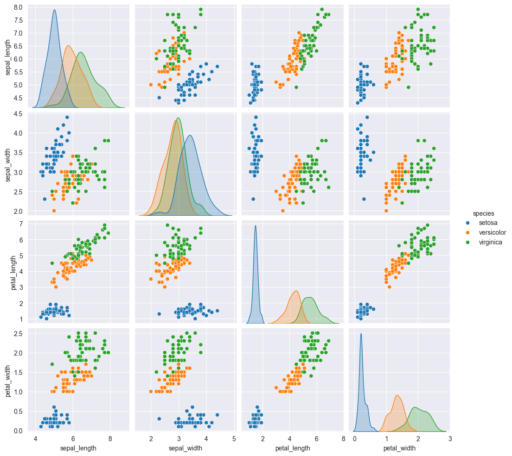
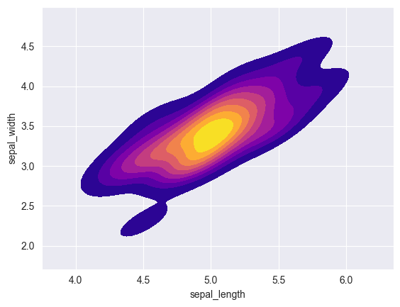

# Lab 10

### Group Members

| Names | ID |
| --- | --- |
| Arwa Alkhathlan | 2250030009 |
| Noor Albuainain | 2250030050 |
| Zainab Alharbi | 2250030246 |
| Joud Albeijan | 2250030261 |
| Sheehana Alghamdi | 2250030084 |
| Reem Alshehab | 2250030257 |


# Support Vector Machines 

Welcome to your SVM assignment! Just follow along with the notebook and instructions below. We will be analyzing the famous iris data set!

## The Data
For this series of lectures, we will be using the famous [Iris flower data set](http://en.wikipedia.org/wiki/Iris_flower_data_set). 

The Iris flower data set or Fisher's Iris data set is a multivariate data set introduced by Sir Ronald Fisher in the 1936 as an example of discriminant analysis. 

The data set consists of 50 samples from each of three species of Iris (Iris setosa, Iris virginica and Iris versicolor), so 150 total samples. Four features were measured from each sample: the length and the width of the sepals and petals, in centimeters.

Here's a picture of the three different Iris types:


```python
# # The Iris Setosa
from IPython.display import Image, display
url = 'http://upload.wikimedia.org/wikipedia/commons/5/56/Kosaciec_szczecinkowaty_Iris_setosa.jpg'
display(Image(url=url, width=300, height=300))
```


```python
# The Iris Versicolor
url = 'http://upload.wikimedia.org/wikipedia/commons/4/41/Iris_versicolor_3.jpg'
display(Image(url=url, width=300, height=300))
```


```python
# The Iris Virginica
url = 'http://upload.wikimedia.org/wikipedia/commons/9/9f/Iris_virginica.jpg'
display(Image(url=url, width=300, height=300))
```


The iris dataset contains measurements for 150 iris flowers from three different species.

The three classes in the Iris dataset:

    Iris-setosa (n=50)
    Iris-versicolor (n=50)
    Iris-virginica (n=50)

The four features of the Iris dataset:

    sepal length in cm
    sepal width in cm
    petal length in cm
    petal width in cm

## Get the data

**Use seaborn to get the iris data by using: iris = sns.load_dataset('iris')**


```python
import seaborn as sns
sns.set_style('darkgrid')
iris = sns.load_dataset('iris')
iris.head()
```


<div>

<table border="1" class="dataframe">
  <thead>
    <tr style="text-align: right;">
      <th></th>
      <th>sepal_length</th>
      <th>sepal_width</th>
      <th>petal_length</th>
      <th>petal_width</th>
      <th>species</th>
    </tr>
  </thead>
  <tbody>
    <tr>
      <th>0</th>
      <td>5.1</td>
      <td>3.5</td>
      <td>1.4</td>
      <td>0.2</td>
      <td>setosa</td>
    </tr>
    <tr>
      <th>1</th>
      <td>4.9</td>
      <td>3.0</td>
      <td>1.4</td>
      <td>0.2</td>
      <td>setosa</td>
    </tr>
    <tr>
      <th>2</th>
      <td>4.7</td>
      <td>3.2</td>
      <td>1.3</td>
      <td>0.2</td>
      <td>setosa</td>
    </tr>
    <tr>
      <th>3</th>
      <td>4.6</td>
      <td>3.1</td>
      <td>1.5</td>
      <td>0.2</td>
      <td>setosa</td>
    </tr>
    <tr>
      <th>4</th>
      <td>5.0</td>
      <td>3.6</td>
      <td>1.4</td>
      <td>0.2</td>
      <td>setosa</td>
    </tr>
  </tbody>
</table>
</div>


Let's visualize the data and get you started!

## Exploratory Data Analysis

Time to put your data viz skills to the test! Try to recreate the following plots, make sure to import the libraries you'll need!

**Import some libraries you think you'll need.**


```python
import matplotlib.pyplot as plt
import seaborn as sns

%matplotlib inline
```

**Create a pairplot of the data set. Which flower species seems to be the most separable?**


```python
sns.pairplot(iris, hue = 'species')
plt.show()
```


    

    


**Create a kde plot of sepal_length versus sepal width for setosa species of flower.**


```python
setosa = iris[iris["species"] == "setosa"]

sns.kdeplot(
    data=setosa,
    x="sepal_length",
    y="sepal_width",
    cmap="plasma",
    fill=True,
)
plt.show()
```


    

    


# Train Test Split

**Split your data into a training set and a testing set.**


```python
from sklearn.model_selection import train_test_split
```


```python
X = iris.drop('species', axis = 1)
y = iris['species']
X_train, X_test, y_train, y_test = train_test_split(X, y, test_size = 0.3, random_state = 101)
```

# Train a Model

Now its time to train a Support Vector Machine Classifier. 

**Call the SVC() model from sklearn and fit the model to the training data.**


```python
from sklearn.svm import SVC
```


```python
mySVC = SVC()
```


```python
mySVC.fit(X_train, y_train)
```

<div id="sk-container-id-1" class="sk-top-container"><div class="sk-text-repr-fallback"><pre>SVC()</pre><b>In a Jupyter environment, please rerun this cell to show the HTML representation or trust the notebook. <br />On GitHub, the HTML representation is unable to render, please try loading this page with nbviewer.org.</b></div><div class="sk-container" hidden><div class="sk-item"><div class="sk-estimator fitted sk-toggleable"><input class="sk-toggleable__control sk-hidden--visually" id="sk-estimator-id-1" type="checkbox" checked><label for="sk-estimator-id-1" class="sk-toggleable__label fitted sk-toggleable__label-arrow"><div><div>SVC</div></div><div><a class="sk-estimator-doc-link fitted" rel="noreferrer" target="_blank" href="https://scikit-learn.org/1.6/modules/generated/sklearn.svm.SVC.html">?<span>Documentation for SVC</span></a><span class="sk-estimator-doc-link fitted">i<span>Fitted</span></span></div></label><div class="sk-toggleable__content fitted"><pre>SVC()</pre></div> </div></div></div></div>


## Model Evaluation

**Now get predictions from the model and create a confusion matrix and a classification report.**


```python
from sklearn.metrics import confusion_matrix, classification_report
```


```python
y_predictions = mySVC.predict(X_test)
```


```python
print(confusion_matrix(y_test, y_predictions))
```

    [[13  0  0]
     [ 0 19  1]
     [ 0  0 12]]
    


```python
print(classification_report(y_test, y_predictions))
```

                  precision    recall  f1-score   support
    
          setosa       1.00      1.00      1.00        13
      versicolor       1.00      0.95      0.97        20
       virginica       0.92      1.00      0.96        12
    
        accuracy                           0.98        45
       macro avg       0.97      0.98      0.98        45
    weighted avg       0.98      0.98      0.98        45
    
    

Wow! You should have noticed that your model was pretty good! Let's see if we can tune the parameters to try to get even better (unlikely, and you probably would be satisfied with these results in real like because the data set is quite small, but I just want you to practice using GridSearch.

## Gridsearch Practice

**Import GridsearchCV from SciKit Learn.**


```python
from sklearn.model_selection import GridSearchCV
```

**Create a dictionary called param_grid and fill out some parameters for C and gamma.**


```python
param_grid = {'C' : [0.1, 1, 10, 100, 1000], 'gamma' : [1, 0.1, 0.01, 0.001, 0.0001]}
```

**Create a GridSearchCV object and fit it to the training data.**


```python
myGS = GridSearchCV(SVC(), param_grid = param_grid, verbose = 3)
myGS.fit(X_train, y_train)
```

    Fitting 5 folds for each of 25 candidates, totalling 125 fits
    [CV 1/5] END ....................C=0.1, gamma=1;, score=0.905 total time=   0.0s
    [CV 2/5] END ....................C=0.1, gamma=1;, score=1.000 total time=   0.0s
    [CV 3/5] END ....................C=0.1, gamma=1;, score=0.905 total time=   0.0s
    [CV 4/5] END ....................C=0.1, gamma=1;, score=0.905 total time=   0.0s
    [CV 5/5] END ....................C=0.1, gamma=1;, score=0.952 total time=   0.0s
    [CV 1/5] END ..................C=0.1, gamma=0.1;, score=0.857 total time=   0.0s
    [CV 2/5] END ..................C=0.1, gamma=0.1;, score=0.714 total time=   0.0s
    [CV 3/5] END ..................C=0.1, gamma=0.1;, score=0.857 total time=   0.0s
    [CV 4/5] END ..................C=0.1, gamma=0.1;, score=0.810 total time=   0.0s
    [CV 5/5] END ..................C=0.1, gamma=0.1;, score=0.810 total time=   0.0s
    [CV 1/5] END .................C=0.1, gamma=0.01;, score=0.714 total time=   0.0s
    [CV 2/5] END .................C=0.1, gamma=0.01;, score=0.714 total time=   0.0s
    [CV 3/5] END .................C=0.1, gamma=0.01;, score=0.714 total time=   0.0s
    [CV 4/5] END .................C=0.1, gamma=0.01;, score=0.714 total time=   0.0s
    [CV 5/5] END .................C=0.1, gamma=0.01;, score=0.714 total time=   0.0s
    [CV 1/5] END ................C=0.1, gamma=0.001;, score=0.333 total time=   0.0s
    [CV 2/5] END ................C=0.1, gamma=0.001;, score=0.333 total time=   0.0s
    [CV 3/5] END ................C=0.1, gamma=0.001;, score=0.714 total time=   0.0s
    [CV 4/5] END ................C=0.1, gamma=0.001;, score=0.714 total time=   0.0s
    [CV 5/5] END ................C=0.1, gamma=0.001;, score=0.714 total time=   0.0s
    [CV 1/5] END ...............C=0.1, gamma=0.0001;, score=0.333 total time=   0.0s
    [CV 2/5] END ...............C=0.1, gamma=0.0001;, score=0.333 total time=   0.0s
    [CV 3/5] END ...............C=0.1, gamma=0.0001;, score=0.714 total time=   0.0s
    [CV 4/5] END ...............C=0.1, gamma=0.0001;, score=0.714 total time=   0.0s
    [CV 5/5] END ...............C=0.1, gamma=0.0001;, score=0.714 total time=   0.0s
    [CV 1/5] END ......................C=1, gamma=1;, score=1.000 total time=   0.0s
    [CV 2/5] END ......................C=1, gamma=1;, score=0.905 total time=   0.0s
    [CV 3/5] END ......................C=1, gamma=1;, score=0.905 total time=   0.0s
    [CV 4/5] END ......................C=1, gamma=1;, score=0.952 total time=   0.0s
    [CV 5/5] END ......................C=1, gamma=1;, score=0.952 total time=   0.0s
    [CV 1/5] END ....................C=1, gamma=0.1;, score=1.000 total time=   0.0s
    [CV 2/5] END ....................C=1, gamma=0.1;, score=1.000 total time=   0.0s
    [CV 3/5] END ....................C=1, gamma=0.1;, score=0.905 total time=   0.0s
    [CV 4/5] END ....................C=1, gamma=0.1;, score=0.905 total time=   0.0s
    [CV 5/5] END ....................C=1, gamma=0.1;, score=1.000 total time=   0.0s
    [CV 1/5] END ...................C=1, gamma=0.01;, score=0.952 total time=   0.0s
    [CV 2/5] END ...................C=1, gamma=0.01;, score=0.810 total time=   0.0s
    [CV 3/5] END ...................C=1, gamma=0.01;, score=0.857 total time=   0.0s
    [CV 4/5] END ...................C=1, gamma=0.01;, score=0.857 total time=   0.0s
    [CV 5/5] END ...................C=1, gamma=0.01;, score=0.905 total time=   0.0s
    [CV 1/5] END ..................C=1, gamma=0.001;, score=0.714 total time=   0.0s
    [CV 2/5] END ..................C=1, gamma=0.001;, score=0.714 total time=   0.0s
    [CV 3/5] END ..................C=1, gamma=0.001;, score=0.714 total time=   0.0s
    [CV 4/5] END ..................C=1, gamma=0.001;, score=0.714 total time=   0.0s
    [CV 5/5] END ..................C=1, gamma=0.001;, score=0.714 total time=   0.0s
    [CV 1/5] END .................C=1, gamma=0.0001;, score=0.333 total time=   0.0s
    [CV 2/5] END .................C=1, gamma=0.0001;, score=0.333 total time=   0.0s
    [CV 3/5] END .................C=1, gamma=0.0001;, score=0.714 total time=   0.0s
    [CV 4/5] END .................C=1, gamma=0.0001;, score=0.714 total time=   0.0s
    [CV 5/5] END .................C=1, gamma=0.0001;, score=0.714 total time=   0.0s
    [CV 1/5] END .....................C=10, gamma=1;, score=1.000 total time=   0.0s
    [CV 2/5] END .....................C=10, gamma=1;, score=0.905 total time=   0.0s
    [CV 3/5] END .....................C=10, gamma=1;, score=0.905 total time=   0.0s
    [CV 4/5] END .....................C=10, gamma=1;, score=0.905 total time=   0.0s
    [CV 5/5] END .....................C=10, gamma=1;, score=0.952 total time=   0.0s
    [CV 1/5] END ...................C=10, gamma=0.1;, score=1.000 total time=   0.0s
    [CV 2/5] END ...................C=10, gamma=0.1;, score=1.000 total time=   0.0s
    [CV 3/5] END ...................C=10, gamma=0.1;, score=0.905 total time=   0.0s
    [CV 4/5] END ...................C=10, gamma=0.1;, score=0.905 total time=   0.0s
    [CV 5/5] END ...................C=10, gamma=0.1;, score=0.952 total time=   0.0s
    [CV 1/5] END ..................C=10, gamma=0.01;, score=1.000 total time=   0.0s
    [CV 2/5] END ..................C=10, gamma=0.01;, score=1.000 total time=   0.0s
    [CV 3/5] END ..................C=10, gamma=0.01;, score=0.905 total time=   0.0s
    [CV 4/5] END ..................C=10, gamma=0.01;, score=0.905 total time=   0.0s
    [CV 5/5] END ..................C=10, gamma=0.01;, score=1.000 total time=   0.0s
    [CV 1/5] END .................C=10, gamma=0.001;, score=0.952 total time=   0.0s
    [CV 2/5] END .................C=10, gamma=0.001;, score=0.810 total time=   0.0s
    [CV 3/5] END .................C=10, gamma=0.001;, score=0.857 total time=   0.0s
    [CV 4/5] END .................C=10, gamma=0.001;, score=0.857 total time=   0.0s
    [CV 5/5] END .................C=10, gamma=0.001;, score=0.905 total time=   0.0s
    [CV 1/5] END ................C=10, gamma=0.0001;, score=0.714 total time=   0.0s
    [CV 2/5] END ................C=10, gamma=0.0001;, score=0.714 total time=   0.0s
    [CV 3/5] END ................C=10, gamma=0.0001;, score=0.714 total time=   0.0s
    [CV 4/5] END ................C=10, gamma=0.0001;, score=0.714 total time=   0.0s
    [CV 5/5] END ................C=10, gamma=0.0001;, score=0.714 total time=   0.0s
    [CV 1/5] END ....................C=100, gamma=1;, score=1.000 total time=   0.0s
    [CV 2/5] END ....................C=100, gamma=1;, score=0.905 total time=   0.0s
    [CV 3/5] END ....................C=100, gamma=1;, score=0.857 total time=   0.0s
    [CV 4/5] END ....................C=100, gamma=1;, score=0.905 total time=   0.0s
    [CV 5/5] END ....................C=100, gamma=1;, score=0.952 total time=   0.0s
    [CV 1/5] END ..................C=100, gamma=0.1;, score=1.000 total time=   0.0s
    [CV 2/5] END ..................C=100, gamma=0.1;, score=0.905 total time=   0.0s
    [CV 3/5] END ..................C=100, gamma=0.1;, score=0.857 total time=   0.0s
    [CV 4/5] END ..................C=100, gamma=0.1;, score=0.905 total time=   0.0s
    [CV 5/5] END ..................C=100, gamma=0.1;, score=0.952 total time=   0.0s
    [CV 1/5] END .................C=100, gamma=0.01;, score=1.000 total time=   0.0s
    [CV 2/5] END .................C=100, gamma=0.01;, score=1.000 total time=   0.0s
    [CV 3/5] END .................C=100, gamma=0.01;, score=0.905 total time=   0.0s
    [CV 4/5] END .................C=100, gamma=0.01;, score=0.905 total time=   0.0s
    [CV 5/5] END .................C=100, gamma=0.01;, score=0.952 total time=   0.0s
    [CV 1/5] END ................C=100, gamma=0.001;, score=1.000 total time=   0.0s
    [CV 2/5] END ................C=100, gamma=0.001;, score=1.000 total time=   0.0s
    [CV 3/5] END ................C=100, gamma=0.001;, score=0.905 total time=   0.0s
    [CV 4/5] END ................C=100, gamma=0.001;, score=0.905 total time=   0.0s
    [CV 5/5] END ................C=100, gamma=0.001;, score=1.000 total time=   0.0s
    [CV 1/5] END ...............C=100, gamma=0.0001;, score=0.952 total time=   0.0s
    [CV 2/5] END ...............C=100, gamma=0.0001;, score=0.810 total time=   0.0s
    [CV 3/5] END ...............C=100, gamma=0.0001;, score=0.857 total time=   0.0s
    [CV 4/5] END ...............C=100, gamma=0.0001;, score=0.857 total time=   0.0s
    [CV 5/5] END ...............C=100, gamma=0.0001;, score=0.905 total time=   0.0s
    [CV 1/5] END ...................C=1000, gamma=1;, score=1.000 total time=   0.0s
    [CV 2/5] END ...................C=1000, gamma=1;, score=0.905 total time=   0.0s
    [CV 3/5] END ...................C=1000, gamma=1;, score=0.857 total time=   0.0s
    [CV 4/5] END ...................C=1000, gamma=1;, score=0.905 total time=   0.0s
    [CV 5/5] END ...................C=1000, gamma=1;, score=0.952 total time=   0.0s
    [CV 1/5] END .................C=1000, gamma=0.1;, score=1.000 total time=   0.0s
    [CV 2/5] END .................C=1000, gamma=0.1;, score=0.905 total time=   0.0s
    [CV 3/5] END .................C=1000, gamma=0.1;, score=0.857 total time=   0.0s
    [CV 4/5] END .................C=1000, gamma=0.1;, score=0.905 total time=   0.0s
    [CV 5/5] END .................C=1000, gamma=0.1;, score=0.952 total time=   0.0s
    [CV 1/5] END ................C=1000, gamma=0.01;, score=1.000 total time=   0.0s
    [CV 2/5] END ................C=1000, gamma=0.01;, score=1.000 total time=   0.0s
    [CV 3/5] END ................C=1000, gamma=0.01;, score=0.857 total time=   0.0s
    [CV 4/5] END ................C=1000, gamma=0.01;, score=0.905 total time=   0.0s
    [CV 5/5] END ................C=1000, gamma=0.01;, score=0.952 total time=   0.0s
    [CV 1/5] END ...............C=1000, gamma=0.001;, score=1.000 total time=   0.0s
    [CV 2/5] END ...............C=1000, gamma=0.001;, score=1.000 total time=   0.0s
    [CV 3/5] END ...............C=1000, gamma=0.001;, score=0.905 total time=   0.0s
    [CV 4/5] END ...............C=1000, gamma=0.001;, score=0.905 total time=   0.0s
    [CV 5/5] END ...............C=1000, gamma=0.001;, score=0.952 total time=   0.0s
    [CV 1/5] END ..............C=1000, gamma=0.0001;, score=1.000 total time=   0.0s
    [CV 2/5] END ..............C=1000, gamma=0.0001;, score=1.000 total time=   0.0s
    [CV 3/5] END ..............C=1000, gamma=0.0001;, score=0.905 total time=   0.0s
    [CV 4/5] END ..............C=1000, gamma=0.0001;, score=0.905 total time=   0.0s
    [CV 5/5] END ..............C=1000, gamma=0.0001;, score=1.000 total time=   0.0s
    

<div id="sk-container-id-2" class="sk-top-container"><div class="sk-text-repr-fallback"><pre>GridSearchCV(estimator=SVC(),
             param_grid={&#x27;C&#x27;: [0.1, 1, 10, 100, 1000],
                         &#x27;gamma&#x27;: [1, 0.1, 0.01, 0.001, 0.0001]},
             verbose=3)</pre><b>In a Jupyter environment, please rerun this cell to show the HTML representation or trust the notebook. <br />On GitHub, the HTML representation is unable to render, please try loading this page with nbviewer.org.</b></div><div class="sk-container" hidden><div class="sk-item sk-dashed-wrapped"><div class="sk-label-container"><div class="sk-label fitted sk-toggleable"><input class="sk-toggleable__control sk-hidden--visually" id="sk-estimator-id-2" type="checkbox" ><label for="sk-estimator-id-2" class="sk-toggleable__label fitted sk-toggleable__label-arrow"><div><div>GridSearchCV</div></div><div><a class="sk-estimator-doc-link fitted" rel="noreferrer" target="_blank" href="https://scikit-learn.org/1.6/modules/generated/sklearn.model_selection.GridSearchCV.html">?<span>Documentation for GridSearchCV</span></a><span class="sk-estimator-doc-link fitted">i<span>Fitted</span></span></div></label><div class="sk-toggleable__content fitted"><pre>GridSearchCV(estimator=SVC(),
             param_grid={&#x27;C&#x27;: [0.1, 1, 10, 100, 1000],
                         &#x27;gamma&#x27;: [1, 0.1, 0.01, 0.001, 0.0001]},
             verbose=3)</pre></div> </div></div><div class="sk-parallel"><div class="sk-parallel-item"><div class="sk-item"><div class="sk-label-container"><div class="sk-label fitted sk-toggleable"><input class="sk-toggleable__control sk-hidden--visually" id="sk-estimator-id-3" type="checkbox" ><label for="sk-estimator-id-3" class="sk-toggleable__label fitted sk-toggleable__label-arrow"><div><div>best_estimator_: SVC</div></div></label><div class="sk-toggleable__content fitted"><pre>SVC(C=1, gamma=0.1)</pre></div> </div></div><div class="sk-serial"><div class="sk-item"><div class="sk-estimator fitted sk-toggleable"><input class="sk-toggleable__control sk-hidden--visually" id="sk-estimator-id-4" type="checkbox" ><label for="sk-estimator-id-4" class="sk-toggleable__label fitted sk-toggleable__label-arrow"><div><div>SVC</div></div><div><a class="sk-estimator-doc-link fitted" rel="noreferrer" target="_blank" href="https://scikit-learn.org/1.6/modules/generated/sklearn.svm.SVC.html">?<span>Documentation for SVC</span></a></div></label><div class="sk-toggleable__content fitted"><pre>SVC(C=1, gamma=0.1)</pre></div> </div></div></div></div></div></div></div></div></div>


**Now take that grid model and create some predictions using the test set and create classification reports and confusion matrices for them. Were you able to improve?**


```python
y_predictions = myGS.predict(X_test)
```


```python
print(confusion_matrix(y_test, y_predictions))
```

    [[13  0  0]
     [ 0 19  1]
     [ 0  0 12]]
    


```python
print(classification_report(y_test, y_predictions))
```

                  precision    recall  f1-score   support
    
          setosa       1.00      1.00      1.00        13
      versicolor       1.00      0.95      0.97        20
       virginica       0.92      1.00      0.96        12
    
        accuracy                           0.98        45
       macro avg       0.97      0.98      0.98        45
    weighted avg       0.98      0.98      0.98        45
    
    
